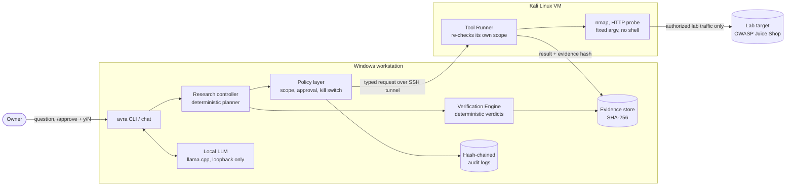

# AVRA — AI Vulnerability Research Agent

AVRA is an independently developed research project: a command-line agent that helps run
**authorized** security investigations in an isolated home lab. A language model can read
evidence, explain results and *propose* the next step. It can never run a tool, widen the
scope or decide that a vulnerability is real. Every action goes through a default-deny scope
check, an explicit human approval and a separate Linux runner, and every result is
hash-checked and written to a tamper-evident audit log.

> **Lab-only.** AVRA has been used only against OWASP Juice Shop (a deliberately vulnerable
> training application) on a VirtualBox host-only network. It is not a production service
> and must not be pointed at systems you are not authorized to test.

## Why it exists

LLMs are useful for reading scan output and suggesting what to check next, but letting a
model run security tools directly is unsafe, and its claims are often wrong. AVRA explores a
stricter split of responsibility:

| Who | Does what |
|---|---|
| Model (local or API) | reads recorded evidence, explains it, proposes one typed action |
| Deterministic code | checks scope, expiry and run limits; plans; decides verdicts from evidence |
| Owner (human) | approves each live action in a real terminal; can stop everything at once |
| Kali Runner | runs only typed, validated requests, re-checks its own scope, returns hashed evidence |

## What works today

Statuses are kept apart on purpose. **Offline-tested** = automated tests with fakes and
recorded fixtures. **Live-validated** = a recorded, owner-approved run in the lab.

| Capability | Status |
|---|---|
| Default-deny scope files (host, port, tool, tier, path, expiry), checked on Windows **and** again on the Runner | offline-tested; used live |
| Kali Tool Runner (Starlette/uvicorn on loopback, bearer auth, reachable only through a restricted SSH tunnel) | live-validated |
| `nmap_connect_scan` (typed request, fixed argv, no shell) | live-validated |
| `http_probe` (one fixed `GET /`) | live-validated |
| `http_get_path` (one fixed GET of a path seen in recorded responses) | offline-tested, deployed, **not yet run live** |
| Hash-chained, single-writer audit logs; optional HMAC anchors (Windows DPAPI key ring) | offline-tested |
| Evidence integrity: SHA-256 per artifact, correlated with the request id in the audit log | offline-tested; used live |
| Deterministic Verification Engine: CONFIRMED / REJECTED / INCONCLUSIVE from evidence only | offline-tested |
| Model-proposes / owner-approves research loop | live-validated (Claude Opus via the Anthropic API) |
| Local model support (llama.cpp / Ollama OpenAI-compatible endpoint, loopback only) | used with a local 27B model |
| `avra chat`: conversational agent, read-only evidence tools, one-action `/approve` | offline-tested; used with the local model |
| Context budgeting, evidence-preserving compaction, deterministic intent gate | offline-tested; evaluated against the local model |
| Persistent, hash-chained investigation state machine + `avra investigate` | offline-tested, **not yet run live** |
| Local kill switch (`avra kill`) + Runner-side cancel / emergency latch | offline-tested; cancel API live-validated; emergency stop **not verified live** |
| Live exploit-style validation | **disabled by design** (simulated fixtures only) |

## Architecture



The model sits **beside** the controller, not in front of the policy layer: its output is a
proposal or an explanation, never an instruction the system obeys.

## Engineering decisions worth looking at

- **Separate Linux runner, typed requests only.** The Windows side never builds shell
  strings. Requests are strict Pydantic models (`extra="forbid"`, canonical IPv4, validated
  paths); the Runner maps them to fixed argument lists.
  `docs/decisions/0003-tool-runner-design.md`
- **Scope enforced twice.** Windows checks the scope when an action is proposed and again
  at approval; the Runner checks its own, independently deployed scope file. An action runs
  only in the intersection. `src/avra/policy/`, `src/avra/runner/`
- **Restricted tunnel.** The tunnel account can only forward to the Runner's loopback port
  (`PermitOpen 127.0.0.1:8765`, `PermitListen none`, `ForceCommand /usr/sbin/nologin`).
  `runner/deploy/`
- **The model never decides a verdict.** Rules in `src/avra/verification/` decide from
  hash-checked evidence; contradicting observations (e.g. 4× open, 1× closed) stay
  INCONCLUSIVE. A missing security header is reported as a hardening gap, not as an
  exploitable vulnerability.
- **Approval cannot be delegated.** Chat text such as "yes, go ahead" approves nothing.
  `/approve <id>` works only in a real terminal, for one action, once, and is followed by a
  second `y/N` confirmation. A one-shot "ha/yes" reply works only for a single, just-proposed
  action and fails closed on any qualifier ("ha, lekin bajarma" = "yes, but don't").
- **Survives interruptions.** Investigations are event-sourced and hash-chained; a crash
  in the middle of an action becomes INTERRUPTED and is never re-run automatically ("at most
  once"). `docs/decisions/0022-m14-investigation-state-machine.md`
- **Small local models handled honestly.** The chat agent detects the server's real context
  window, counts tokens with the server's own tokenizer, compacts tool results without
  altering ids, hashes or verdicts, and retries at most once on a context error.
  `docs/decisions/0023-m14.5-local-ai-reliability.md`

All 23 architecture decision records are in [`docs/decisions/`](docs/decisions/).

## Technology

Python 3.12 · Pydantic v2 · Typer · PyYAML · defusedxml · official `anthropic` SDK ·
Starlette + uvicorn (Runner only) · JSONL audit logs and file-based evidence storage ·
OpenSSH (restricted tunnel) · systemd (Runner service on Kali) · llama.cpp `llama-server`
for local inference (client uses only the standard library) · pytest · Ruff.

Lab: Windows 11 host, VirtualBox host-only network, Kali Linux (Runner), Ubuntu + Docker
(Juice Shop).

## Try it offline (no lab, no model, no credentials)

```powershell
git clone https://github.com/khosilbekmamirov/avra-security-agent.git
cd avra-security-agent
python -m venv .venv; .\.venv\Scripts\Activate.ps1          # Python 3.12+
pip install -e . pytest ruff "httpx==0.28.1" "starlette==1.9.0" "uvicorn==0.54.0"

# work on a COPY of the synthetic session fixtures
Copy-Item -Recurse tests\fixtures\synthetic-sessions demo-data
$env:AVRA_DATA_DIR = "demo-data"

avra check-scope scope\example.scope.yaml
avra verify rules
avra verify session --session 7e868faf-768d-49af-aea6-81dc9d435e20
avra verify check 7e868faf-768d-49af-aea6-81dc9d435e20
avra validate fixture --file tests\fixtures\validation\idor-cross-account-read.json
```

Expected: the scope file is valid; the Verification Engine re-derives its verdicts from the
synthetic evidence (one verified observation, one rejected hypothesis) and `verify check`
prints `VERIFIED`; the validation result is labelled **SIMULATED-FIXTURE**. None of these
commands opens a network connection. Example output: [`docs/demo-output.md`](docs/demo-output.md).

## Tests

```powershell
python -m pytest -q
python -m ruff check src tests
```

The tested commit and results are in [`docs/TESTING.md`](docs/TESTING.md).

## Limitations

- Validated only in a lab, against one training application.
- `http_get_path`, `avra investigate` and the Runner's emergency stop have not been run live.
- The local 27B model (1.58-bit, 8 GB GPU) needs about 25–40 s per answer; its Uzbek is
  understandable but not fluent. English answers are more reliable.
- Single-operator design: no web UI and no multi-user access control.
- The intent and approval word lists are heuristics that fail closed: an unusual phrasing of
  a real request may need to be rephrased.

## How it was built

I designed and directed AVRA: I set its safety rules, made and recorded the architecture
decisions, built and operated the lab (VMs, network isolation, SSH, Runner deployment),
approved and ran every live action, and reviewed the results. Most of the code was written
with **Claude Code as an AI pair-programmer**, under a written engineering protocol: small
reviewed increments, tests before "done", an ADR for every significant decision, and no live
action without my approval.

Internal working notes (session hand-offs, development log, local environment details) are
kept private; some documents mention them.

## Security

See [`SECURITY.md`](SECURITY.md), [`docs/security.md`](docs/security.md) and
[`docs/threat-model.md`](docs/threat-model.md).

## Author

Khosilbek Mamirov — [github.com/khosilbekmamirov](https://github.com/khosilbekmamirov)

## License

No open-source license has been granted: all rights reserved. You may read the code and run
the offline demo to evaluate it.
